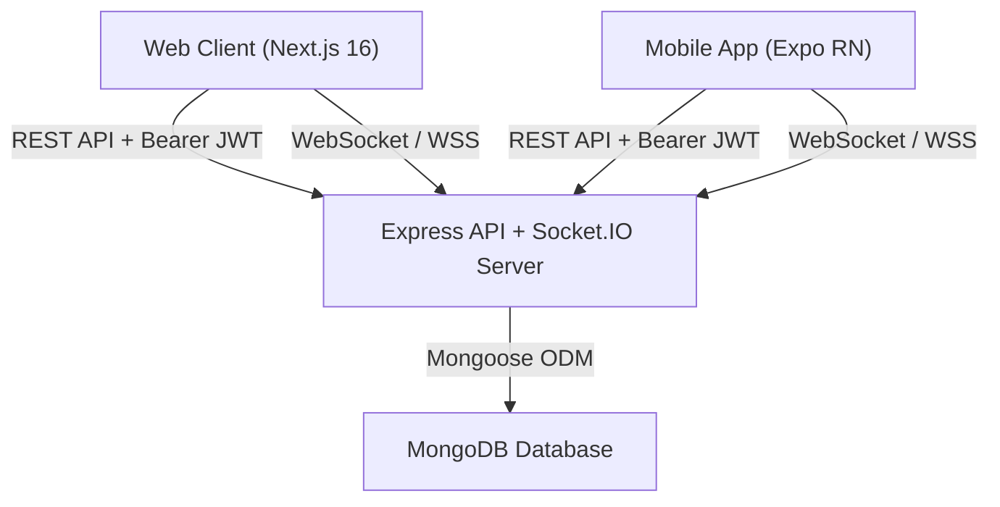
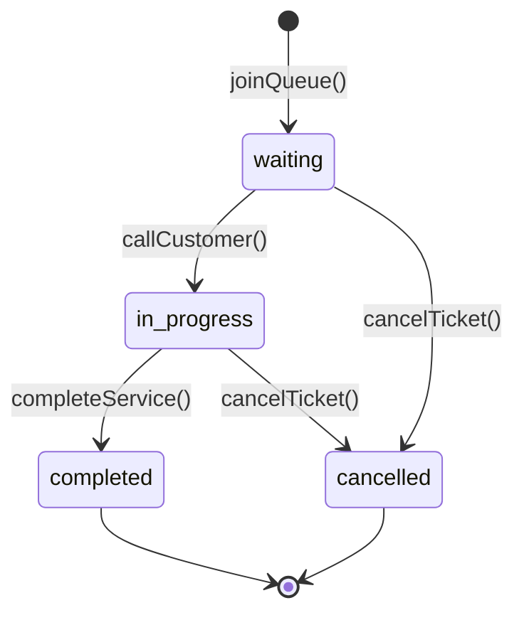

# QueueLess — System Architecture Documentation

## 1. System Overview
QueueLess is a real-time virtual queue management platform consisting of three coordinated applications:
- **Backend (`/backend`)**: Express, TypeScript, MongoDB (Mongoose), Socket.IO.
- **Web Frontend (`/frontend`)**: Next.js 16 (Turbopack, App Router), React 19, Tailwind CSS, Framer Motion.
- **Mobile App (`/mobile`)**: Expo SDK 57, React Native 0.86, TypeScript.



---

## 2. Component Hierarchy & Responsibilities

### 2.1 Backend Architecture
```
backend/src/
├── controllers/          # HTTP request handlers (thin orchestrators)
│   ├── authController.ts
│   ├── businessController.ts
│   └── queueController.ts
├── services/             # Core business logic (centralized, reusable)
│   └── queueService.ts   # authoritative queue & wait time engine
├── middleware/           # Cross-cutting concerns
│   ├── authMiddleware.ts # JWT verification & role enforcement
│   ├── validation.ts     # Schema validation for request payloads
│   └── errorHandler.ts   # Centralized error formatter & request ID
├── models/               # MongoDB Mongoose schemas
│   ├── User.ts           # Customer & Business accounts
│   ├── QueueEntry.ts     # Tickets & status history
│   └── ShareToken.ts     # Scoped public sharing tokens (Phase 7)
├── routes/               # API endpoint routing definitions
└── index.ts              # Server bootstrap, Socket.IO & database connection
```

### 2.2 Queue Lifecycle State Machine

- **Disallowed Transitions:**
  - `completed` -> `waiting` (cannot revive finished tickets)
  - `cancelled` -> `in_progress` (cancelled tickets are terminal)
  - `waiting` -> `completed` (must be marked `in_progress` before completion)

---

## 3. Real-Time Synchronization Protocol

### 3.1 Socket Rooms
- `business_{businessId}`: Authenticated room for the business merchant. Receives `queue_updated` when customers join or change position.
- `queue_{queueEntryId}`: Private room for a specific ticket. Authorized strictly to the ticket owner or merchant. Receives `status_updated`.

### 3.2 Resilience & Reconciliation
Socket.IO is used exclusively as a fast notification layer. MongoDB remains the authoritative source of truth.
Clients must always execute a REST fetch on reconnect or visibility restoration to reconcile state.
