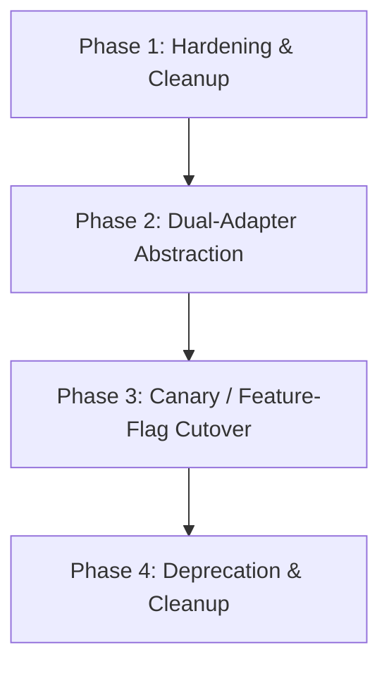

# Controlled Migration Plan: Legacy `@google/generative-ai` to Modern `@google/genai` SDK

## 1. Executive Summary & Rationale

QueueLess currently integrates Google Gemini for authenticated customer and merchant AI support using `@google/generative-ai` version `0.24.1`. 

According to Google AI for Developers official guidelines:
- The `@google/generative-ai` SDK is designated as **legacy** and is no longer actively maintained.
- The next-generation unified SDK **`@google/genai`** is the officially supported standard for Node.js, TypeScript, and web developers, featuring first-class support for Gemini 2.x and 3.x models, improved request lifecycle controls, integrated schema generation, and unified multimodal streaming.

This document establishes the controlled, zero-downtime migration roadmap to upgrade QueueLess's AI infrastructure without impacting customer queues, merchant operations, or existing support conversations.

---

## 2. API Surface & Architectural Differences

| Feature Dimension | Legacy SDK (`@google/generative-ai` v0.24.x) | Modern SDK (`@google/genai` v2.x / v3.x) |
| :--- | :--- | :--- |
| **Package Identifier** | `@google/generative-ai` | `@google/genai` |
| **Client Initialization** | `new GoogleGenerativeAI(apiKey)` | `new GoogleGenAI({ apiKey })` |
| **Model Handle Lifecycle** | Two-step: `genAI.getGenerativeModel({ model })` -> `model.startChat()` | Single unified client: `ai.chats.create({ model, config })` |
| **System Instruction** | Parameter inside `ModelParams.systemInstruction` | Dedicated property inside request `config: { systemInstruction: ... }` |
| **Generation Config** | `generationConfig: { maxOutputTokens, temperature }` | `config: { maxOutputTokens, temperature, responseMimeType }` |
| **Timeout & Abort** | Custom `SingleRequestOptions.signal` on `sendMessage` | Standard Node 18+ `fetch` integration with `AbortSignal` |
| **Model Deprecations** | Silent failures or 404 for removed v1beta model IDs | Structured error codes and automated model version alias resolution |

---

## 3. Impact Assessment on QueueLess Codebase

### Isolated Scope (High Modularity)
Because Phase 2 adhered to strict hexagonal architecture, provider interactions are strictly isolated inside `backend/src/services/geminiSupportService.ts`.

- **Frontend (`/frontend`)**: **0% change required**. The HTTP API contract (`POST /api/support/chat`) remains identical.
- **Mobile (`/mobile`)**: **0% change required**. React Native consumer components consume the same response payload.
- **Controllers (`supportController.ts`)**: **0% change required**. Controller consumes `SupportChatResult`.
- **Database / Models**: **0% change required**. No changes to MongoDB schemas or indexes.

### Files Touched During Migration
1. `backend/package.json`: Dependency addition (`@google/genai`) and eventual removal of `@google/generative-ai`.
2. `backend/src/services/geminiSupportService.ts`: Adapter implementation and SDK cutover.
3. `backend/src/__tests__/supportAndConsent.test.ts`: Integration test suite verification.

---

## 4. Phased Migration Roadmap



### Phase 1: Hardening & Cleanup (Completed)
- Extracted `executeChatTurnWithTimeout` with explicit `finally` block `clearTimeout` to eliminate event loop leaks.
- Wired native `AbortController.signal` into `SingleRequestOptions` to abort pending network sockets on timeout.
- Implemented `categorizeSupportError` to isolate `TIMEOUT`, `QUOTA_EXHAUSTED`, `MODEL_NOT_FOUND`, `INVALID_CONFIG`, and `TEMPORARY_PROVIDER_FAILURE`.
- Normalization logic ensuring active models (`gemini-3.8-flash` primary, `gemini-flash-latest` fallback) are selected.

### Phase 2: Dual-Adapter Abstraction Layer
Introduce a formal adapter interface in `backend/src/services/ai/types.ts`:

```typescript
export interface IAISupportAdapter {
  sendTurn(params: {
    modelName: string;
    systemInstruction: string;
    history: Array<{ role: "user" | "model"; text: string }>;
    message: string;
    timeoutMs: number;
    signal?: AbortSignal;
  }): Promise<string>;
}
```

Implement two concrete adapters:
1. `GenerativeAiLegacyAdapter` (wrapping current `@google/generative-ai`).
2. `GenAiModernAdapter` (wrapping `@google/genai` `GoogleGenAI` client).

### Phase 3: Canary / Feature-Flag Rollout
Deploy with environment-controlled adapter switching:

```env
# Values: "modern" | "legacy"
GEMINI_SDK_PROVIDER=modern
```

1. Deploy modern adapter to staging / test environment.
2. Run automated test suites:
   - `npm test -- src/__tests__/supportAndConsent.test.ts`
3. Execute canary traffic in production (10% -> 50% -> 100%).
4. Monitor structured metrics for `failureCategory` rates and duration milliseconds.

### Phase 4: Full Cutover & Deprecation
1. Remove `@google/generative-ai` from `backend/package.json`.
2. Retire `GenerativeAiLegacyAdapter`.
3. Standardize all AI support calls directly on `@google/genai`.

---

## 5. Rollback & Fail-Safe Plan

1. If the modern SDK encounters unexpected runtime issues under production load:
   - Set `SUPPORT_AI_ENABLED=false` to immediately switch to the deterministic offline support desk fallback without restarting the server.
   - Alternatively, toggle `GEMINI_SDK_PROVIDER=legacy` for an instant hot-revert.
2. The structured escalation messages (`getFailureEscalationMessage`) ensure customers always receive direct contact options (`support@queueless.local`) regardless of underlying provider state.

---

## 6. Verification & Acceptance Criteria

- [x] All timeout timers are cleared in a `finally` block when Gemini responds first.
- [x] Abort cancellation signals are propagated to prevent orphan socket connections.
- [x] Errors are cleanly categorized (`TIMEOUT`, `QUOTA_EXHAUSTED`, `MODEL_NOT_FOUND`, `INVALID_CONFIG`, `TEMPORARY_PROVIDER_FAILURE`) in internal logs without leaking API keys.
- [x] Primary and fallback models verified live against Google AI API.
- [x] TypeScript compiler passes cleanly (`npx tsc --noEmit`).
- [x] All 11 Jest test suites (141 tests) pass without regression.
